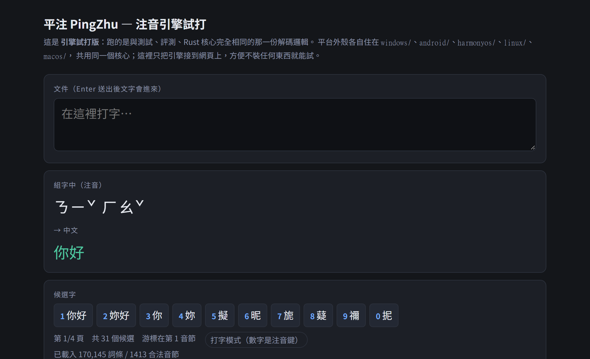
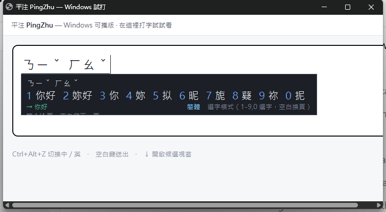
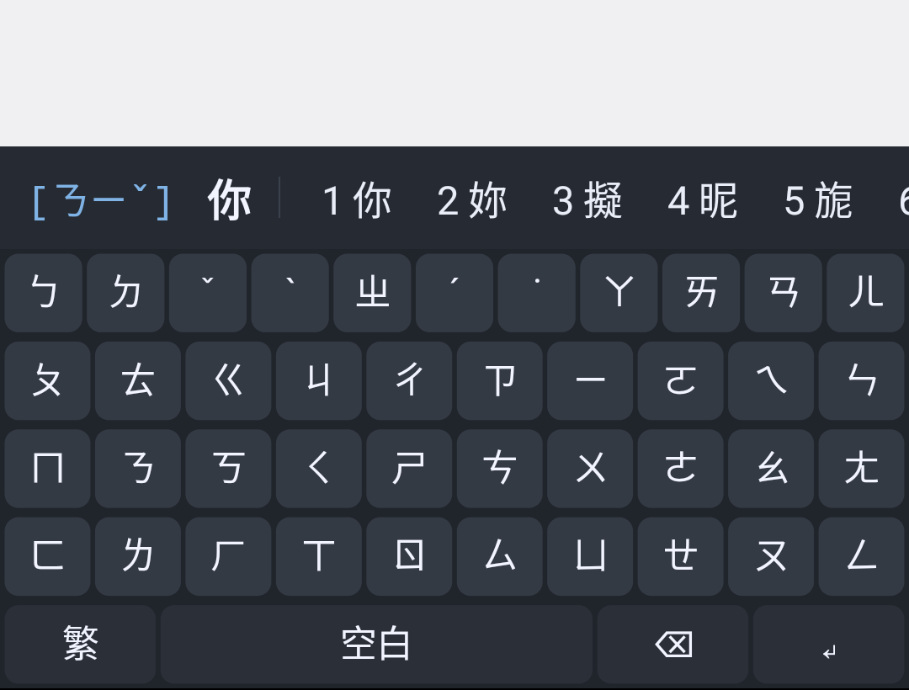
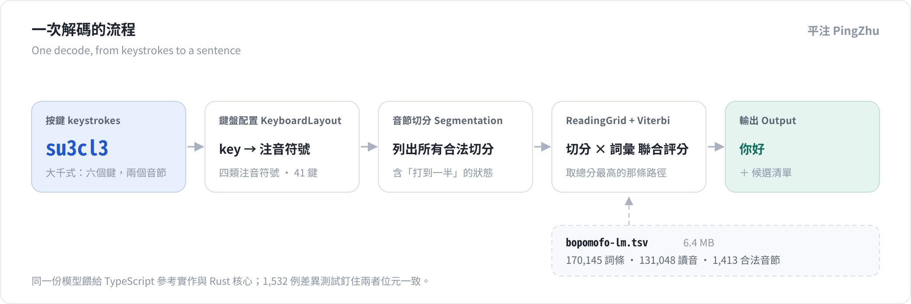
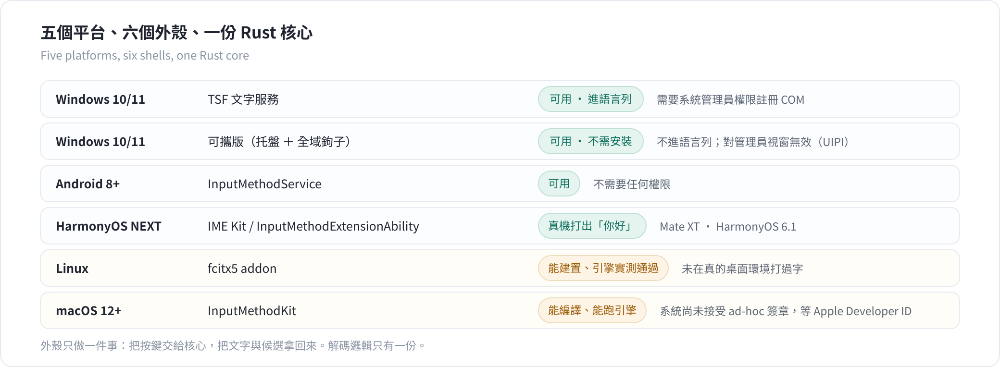
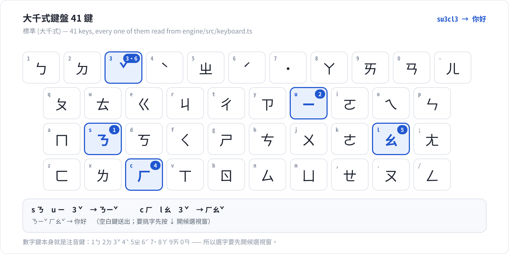

# 平注 PingZhu

[English](README.md) ｜ **简体中文**

[](https://github.com/173787247/pingzhu/releases) [](#快速开始) [](LICENSE) [](NOTICE)

一套开源、跨平台的**注音（Bopomofo／Zhuyin）输入法**，覆盖 Windows、Android、macOS、
HarmonyOS NEXT 与 Linux。

取名「平注」（píng zhù）——*平实的注音*——理由和「自然输入法」一样：它说明这东西做什么，
而且不是任何人的商标。

**[▶ 线上试打](https://173787247.github.io/pingzhu/)** ——不用装任何东西。
打 `su3cl3` 就能看引擎解码，用的是测试套件跑的同一份模组。



*线上试打版跑的是真引擎，图中 `su3cl3` 已打完但还没送出。从上往下：**组字中**
一行是这六个按键拼出来的读音（ㄋㄧˇ ㄏㄠˇ）；**→ 中文**一行是解码器会送出的句子
（你好），标成绿色是因为它同时也是最佳候选；**候选字**一列是第一页的全部内容——这个
读音一共 31 个候选、分 4 页，排序用的就是选出句子那套分数。徽章写着
「打字模式（数字是注音键）」：大千式键盘上 `3` 是 ˇ、`6` 是 ˊ，所以数字要等候选视窗
打开才是选字键。最下面一行是载入状态：170,145 个词条、1,413 个合法音节。*

---

## 下载

| 平台 | 文件 |
|---|---|
| **Windows 10/11** | **[⬇ 安装包 pingzhu-0.10.3-setup.exe](https://github.com/173787247/pingzhu/releases/download/v0.10.3/pingzhu-0.10.3-setup.exe)**　·　[便携版 ZIP](https://github.com/173787247/pingzhu/releases/download/v0.10.3/pingzhu-0.10.3-win-x64.zip) |
| **Android 8+** | **[⬇ pingzhu-0.10.3-android.apk](https://github.com/173787247/pingzhu/releases/download/v0.10.3/pingzhu-0.10.3-android.apk)** |
| **macOS 12+** ⚠️ | **[pingzhu-0.9.0-macos-UNVERIFIED.zip](https://github.com/173787247/pingzhu/releases/download/v0.8.0/pingzhu-0.9.0-macos-UNVERIFIED.zip)**（[先在真机验证](macos/TESTING.md)）<br>**0.10.3 不含 macOS 产物**——输入法要向系统登记，签章必须是 Apple 签发的 Developer ID，而该入会仍在等。 |

**HarmonyOS** 没有安装包——它的产物是工程，要从源码构建。
**Linux** 有 `.deb` 与 `.rpm` 两种包，也可以自己从源码构建 fcitx5 addon：

| 平台 | 拿什么 | 怎么装 |
|---|---|---|
| **HarmonyOS NEXT** | **[pingzhu-0.10.3-harmonyos-project.zip](https://github.com/173787247/pingzhu/releases/download/v0.10.3/pingzhu-0.10.3-harmonyos-project.zip)** | 在 DevEco 打开 `harmonyos/`、签名、Run（[步骤](harmonyos/README.md)） |
| **Linux** | **[fcitx5-pingzhu_0.10.3_amd64.deb](https://github.com/173787247/pingzhu/releases/download/v0.10.3/fcitx5-pingzhu_0.10.3_amd64.deb)**　·　[fcitx5-pingzhu-0.10.3-1.x86_64.rpm](https://github.com/173787247/pingzhu/releases/download/v0.10.3/fcitx5-pingzhu-0.10.3-1.x86_64.rpm) | Debian 系 `sudo dpkg -i …`　·　RPM 系 `sudo rpm -ivh …`（[linux/](linux/README.md)） |

**Windows**：装到 `%LOCALAPPDATA%\Programs\PingZhu`，不需要管理员权限。装好后 `Ctrl+Alt+Z`
切换中英、`Ctrl+Alt+S` 切换繁简（或用角落的浮动按钮），打 `su3cl3` 会出现「你好」。
详细操作见 [windows/README.md](windows/README.md)。



*可携版（`pingzhu-ime.exe`）在 Windows 11 的真实窗口里跑，已打 `su3cl3` 并按下 `↓`。
组字行是 ㄋㄧˇ ㄏㄠˇ——这些按键**从来没进到应用程式里**，因为 `s` 等都是注音键而不是文字。
候选视窗显示的是四页里的第一页（共 31 个候选），底下 `→ 你好` 就是按空白会送出的东西。
数字只在这里、也就是**選字模式**下才是选字键；视窗关着时它们又是注音键
（1 ㄅ 2 ㄉ 3 ˇ 4 ˋ 5 ㄓ 6 ˊ 7 ˙ 8 ㄚ 9 ㄞ 0 ㄢ）。这张图是**修正前**拍的：当时
「選字模式」下面那行状态比装它的视窗矮了一行，下半截被切掉；行距现在收进
`candidate_window.h` 的 `layout::` 常量、画的地方和算高度的地方共用同一份，
`pingzhu-candidate-test.exe` 盯着它不再跑掉。*

**Android**：安装后到「设置 → 系统 → 语言与输入 → 虚拟键盘」启用，再选为输入法。
不需要任何权限——不联网、不读存储、不碰通讯录。详细操作见 [android/README.md](android/README.md)。



*跑在 Android 13（API 33）模拟器上——Pixel 5 尺寸的 x86_64 镜像，在 WSL 里用 KVM 启动，
APK 已安装、输入法已选中，图上打了 `su3` 再按空白。键盘上方那条是候选列：左边是正在组字的
`ㄋㄧˇ`，接着是按空白会送出的词，右边是**编号的候选**，按数字键取用。这个键面不是手画的素材：
`Engine.keyboardRows()` 从**解码器读的同一张表**推出每个键，而且有一个测试
（`the_drawn_keyboard_matches_the_decoder`）把两者钉在一起。注意数字那一排——`1` 是 ㄅ、
`3` 是 ˇ、`6` 是 ˊ，它们是注音键，只有在候选列开着的时候才是选字键，和桌面版一致。*

所有外壳都写同一份 `pingzhu.ini`，所以同一个设置在哪个平台上都是同一个意思。

---

## 一串按键怎么变成一个汉字



*一次解码，从左到右。**键盘配置（KeyboardLayout）**把一个按键变成注音成分——声母、介音、
韵母、声调，`s` 是 ㄋ、`u` 是 ㄧ、`3` 是 ˇ。**音节切分**枚举这些成分所有合法的断句方式，
包括人打字打到一半的那些中间状态。**ReadingGrid + Viterbi**把每个音节跨度上所有能放的
词条铺成一张读字格，把「怎么切」和「选哪个词」放在**同一次评分**里算，最后取总分最高的
那条路径。输出是一个句子加一份候选清单，而候选清单来自同一批分数——所以排序和默认值
不可能互相矛盾。这张图由 [`tools/render-figures.mjs`](tools/render-figures.mjs) 从引擎
真正载入的那份 `data/bopomofo-lm.tsv` 生成，图上的数字不会和引擎脱节。*

有一条规则值得单独命名：词典里某个词条的分数，不得低于它自己那个跨度的最佳切分
（`promoteWordsOverDecomposition`）。没有这条规则，解码器宁可要三个平庸的汉字，
也不要一个像样的词。

**TypeScript 引擎是规格本身。** Rust 核心被 1,532 条记录下来的按键串钉在它身上，
而每个平台外壳内嵌的都是这个 Rust 核心。一份解码器、五个平台——同一个词在手机上解出来
和桌面上不一样，那是一个有名字的 bug，不是「移植漂移」这种自然现象。

---

## 现况



**五个平台、六个外壳、一份 Rust 核心。**

| 平台 | 官方框架 | 引擎 | 外壳状态 |
|---|---|---|---|
| **Windows 10/11** | **TSF 文字服务（进语言列）** | ✅ C ABI | ✅ **可用**（[windows/](windows/README.md)） |
| Windows 10/11 | 便携版（托盘 + 全局钩子 + 注入） | ✅ C ABI | ✅ 可用（不需管理员权限） |
| **Android 8+** | **`InputMethodService`** | ✅ C ABI（JNI） | ✅ **可用**（[android/](android/README.md)） |
| **HarmonyOS NEXT** | **IME Kit / `InputMethodExtensionAbility`** | ✅ C ABI（NAPI，静态链接） | ✅ **在真机（Mate XT · HarmonyOS 6.1）打出「你好」**（[harmonyos/](harmonyos/README.md)） |
| **Linux** | **fcitx5 addon** | ✅ C ABI（静态链接） | ⚠️ **能构建、引擎实测通过**（[linux/](linux/README.md)）·**未在真的桌面环境打过字** |
| **macOS 12+** | **InputMethodKit (IMK)** | ✅ C ABI | ⚠️ **真机上能编译、能打包、能跑引擎**·**但系统尚未接受它**（[macos/](macos/README.md)） |

同一串按键在 Windows 和 Android 上得到同样的词——这不是设计意图，而是差异测试把
1,532 条按键串分别喂给两份实现，逐条比对组字文字、选定句子、分数、路径词与候选第一页。

Windows 有两个外壳，共用同一份引擎与同一个候选视窗：

- **TSF 文字服务**（`pingzhu-tsf-*.dll`）——进语言列，`Win+Space` 可切换，对管理员视窗也可用。
  注册需要管理员权限（COM 伺服器与 CTF 语言设定档都在 HKLM）。
- **便携版**（`pingzhu-ime.exe`）——托盘常驻 + 全局键盘钩子 + `SendInput` 注入。
  不需要安装、不需要管理员权限、不写登录档，代价是不进语言列、对管理员视窗无效（UIPI）。

两个外壳都支援**繁简输出切换**（`pingzhu.ini`），内部一律以繁体解码，只在输出边界转换。

### 两个还没打勾的

**macOS**：它在真机上编译、打包、签章、跑引擎全部通过，输入法选单里却始终没有它。
**原因已经找到**：macOS 26 不注册 ad-hoc 签名的输入法——`spctl` 返回 `rejected`，
而 `TISCreateInputSourceList` 报它「根本没安装」。CI 跑在 macOS 14 上，那里 ad-hoc 可以，
所以每次构建都是绿的。修法是一张 Apple 签发的 Developer ID——细节在
[macos/README.md](macos/README.md)。

**Linux**：引擎在 CI 上跑过同样三个词，addon 也真的被 fcitx5 载入、启动过引擎；
**但「在桌面环境里打字」没有测成功**，因为 WSLg 不转发输入法——原因在
[linux/README.md](linux/README.md)。

---

## 按键本身什么也决定不了


*`ji394su3` 是经典例子，而且两行的数字都是引擎自己算的。键盘给出 ㄨㄛˇ-ㄞˋ-ㄋㄧˇ
（我愛你，一个横跨三个音节的词，−5.398）；但同样这八个按键也给出 ㄨㄛˇ-ㄋㄞˋ-ㄧˇ，
那是三个再普通不过的字：我 耐 以，−9.678。按键串里没有任何东西标记「一个音节在哪里结束」，
所以两条读法都合法；分数是 log₁₀ 机率，越大越好，差距 4.28。这个差距就是「音节切分和
词汇选择必须一次算完」的全部理由：先切分再选词的解码器，在还不知道自己要选哪个词的时候
就已经被迫表态了。这张图把 `ReadingGrid` 跑了两遍——一遍是对整个按键串 `press()`，
一遍是强行指定另一种切法——所以两个数都能用 `node tools/render-figures.mjs` 复现。*

---

## 键盘



*大千式键位——台湾使用者说「注音键盘」时指的就是它——全部 41 个键，注音符号直接读自
引擎的键位表，不是手抄的。高亮的是 `su3cl3` 的六次按键：s ㄋ → u ㄧ → 3 ˇ 得到 ㄋㄧˇ，
c ㄏ → l ㄠ → 3 ˇ 得到 ㄏㄠˇ。注意数字那一排是什么：`1` 是 ㄅ、`3` 是 ˇ、`6` 是 ˊ、
`0` 是 ㄢ。数字本身就是注音键，这就是候选视窗需要一个明确「打开」状态的原因——视窗没开时
`1` 打的是 ㄅ，要按 `↓` 或空白才会变成「选第一个候选」。另有一套**倚天式**键位表与它并列，
并逐键对过 libchewing。*

---

## 为什么要做这个

### 0. 注音略省力——但比直觉小，而且是量出来的

关于注音最有趣的讲法是「它比拼音快」。是快，但诚实的数字比流传的数字小。
[`tools/zhuyin-vs-pinyin.mjs`](tools/zhuyin-vs-pinyin.mjs) 在整份语言模型上算（不是抽样），
并且把两种成本分开计：**拼**出音节，以及从候选里**选**对词。2026-10-11 量的，
取 139,158 条 2–4 音节、一字一音的条目：

| | 注音 | 拼音 | 差别 |
|---|---|---|---|
| 组字按键／字（词频加权） | 2.94 | 3.02 | |
| **有效按键／字**（组字 ＋ 选字） | **2.95** | **3.07** | **注音少 3.8%** |
| 首选正确率（词频加权） | 97.98% | 87.58% | |
| 首选正确率（每条例等权） | 90.68% | 71.26% | |
| 平均同码候选数（等权） | 1.23 | 2.28 | |

放到全部词条（含单字）上，差距拉大到 **5.0%**（有效按键 3.00 对 3.16，词频加权）。
在词的范围内，这点节省约 63% 来自组字、37% 来自选字：拼音在 `zhong` 这种拼法上的劣势，
有一部分被它更长的候选单还了回去。

**3.8–5.0% 是上界。** 拼音那一侧是一个称职但不出色的实作，真实世界的拼音输入法比它强。
这项量测的重点不是「注音赢很多」，而是**这个论证应该用一个数字来说，而那个数字比通常
引用的要小**。完整方法与限制见 [docs/09](docs/09-zhuyin-vs-pinyin.md)。

### 1. 自然输入法没有行动版，而且官方写得很清楚

自然输入法（网际智慧 IQ Technology，1995 年上市）只有 Windows 与 macOS 两个桌面版本。
官方客服中心甚至直接以「不支援」为标题发布条目：iPad、iPhone、Linux、Android 平板
各一条。

### 2. 授权模式制造了大量摩擦

客服内容的分布压倒性地是授权到期、换电脑、扣款失败、登录失败，而不是「怎么打字」。
那是商业模式的产物，不是技术的。

### 3. 开源生态有零件，但没有成品

零件其实不缺——McBopomofo 的 MIT 资料与解码器、libtabe 的 `tsi.src`、OpenCC 的转换表——
缺的是把它们组装成一个跨平台输入法的人。

---

## 快速开始

需要 Node.js ≥ 22.6（用到内建 TypeScript 型别剥离，不需要构建步骤、零运行时依赖）。

```bash
git clone <this-repo> && cd pingzhu

# 互动模式：直接敲注音按键，即时看解码结果
node engine/cli.ts

# 非互动
node engine/cli.ts su3cl3 ji394su3 w96j0
node engine/cli.ts --layout eten ne3        # 倚天式键盘

# 测试与评测
(cd engine && node --test)                  # 68 项
node engine/bench.mjs 5000                  # 解码品质，可重跑（seed 20260926）
node engine/bench.mjs 5000 --compare        # promotion 开与关的逐例对比
node engine/bench-learn.mjs 5000            # 个人化：教一次到底买到什么
node engine/bench-learn.mjs 5000 --recall   # 想要的候选到底够不够得着

# 本 README 里的配图
node tools/render-figures.mjs               # 产 PNG 需要 rsvg-convert
```

```console
$ node engine/cli.ts su3cl3 ji394su3

> su3cl3
  按鍵      su3cl3
  注音      ㄋㄧˇ ㄏㄠˇ
  → 中文    你好   (score -5.09)
  斷詞      你好
  候選      1.你好  2.妳好  3.你  4.妳  5.擬  6.昵  7.旎  8.薿  9.禰  0.抳
            第 1/4 頁（空白鍵下一頁）　打字模式（空白送出；數字是注音鍵；↓ 開啟選字）　游標在第 1 音節

> ji394su3
  注音      ㄨㄛˇ ㄞˋ ㄋㄧˇ
  → 中文    我愛你   (score -5.40)
  斷詞      我愛你
```

| 按键 | 输出 | 为什么放这一条 |
|---|---|---|
| `su3cl3` | 你好 | 基本情况 |
| `ji394su3` | 我愛你 | 切分有歧义——见上面那张图 |
| `w96j0` | 台灣 | 第二个音节不必打声调键 |
| `rupwu0` | 今天 | 一声根本不打键 |
| `g4` | 是 | ㄕ 单独成音 |
| `j0420` | 萬丹 | 声调不会跑到下一个音节 |

互动模式下：`空白鍵` 送出（候选视窗开着时翻下一页）、`↓` 开启候选、开启后 `1`–`9`/`0` 选字、
`←`/`→` 沿组字缓冲区移动游标。

---

## 当成函式库使用

引擎可以独立使用，零执行期依赖：

**方式一：从 release 上的 tarball 装**（零帐号、零设定，**推荐**）

```bash
npm install https://github.com/173787247/pingzhu/releases/download/v0.10.3/pingzhu-engine-0.10.3.tgz
```

**方式二：从 GitHub Packages 装**（要先配 GitHub token）

```bash
npm install @173787247/pingzhu-engine
```

> GitHub Packages **连安装公开套件都要求认证**——这不是猜测，是在这个套件上实测的：
> `npm error 401 Unauthorized - authentication token not provided`
>
> 要用的话先配一次：`echo "//npm.pkg.github.com/:_authToken=$(gh auth token)" >> ~/.npmrc`

```js
import { InputEngine, LAYOUTS } from "pingzhu-engine";
import { loadDictionary, loadSyllableInventory, loadConverter } from "pingzhu-engine/node";
import { createRequire } from "node:module";
import { dirname } from "node:path";

const require = createRequire(import.meta.url);
const data = dirname(require.resolve("pingzhu-engine/data/bopomofo-lm.tsv"));

const engine = new InputEngine(
  loadDictionary(`${data}/bopomofo-lm.tsv`),
  loadSyllableInventory(`${data}/bopomofo-lm.tsv`),
  { layout: LAYOUTS.standard, converter: loadConverter(`${data}/ts-conversion.tsv`) },
);

for (const key of "su3cl3") engine.press(key);
engine.bestSentence;    // 你好
engine.commit();        // 你好
```

主入口**不 import 任何 Node 内建模组**，所以浏览器与打包器都能用；文件系统相关的工具在
`/node` 子路径。这个分割由测试钉住，不是靠注解。

---

## 架构

```
                     data/bopomofo-lm.tsv  （170,145 词条 / 131,048 读音）
                     data/ts-conversion.tsv （繁体 → 简体）
                                  │
              ┌───────────────────┴───────────────────┐
              │                                       │
     engine/  TypeScript                     core-rs/  Rust
     参考实作（规格本身）                      与它位元一致
     68 项测试                                26 项测试 + 1,532 例差异测试
              │                                       │
              │                        ┌──────────────┼──────────────┐
              │                        │              │              │
              │                   windows/        android/      harmonyos/
              │                   TSF + 便携版     JNI + Kotlin   NAPI + ArkTS
              │                        │              │              │
              └──── 同一份资料 ─────────┴──────────────┴──────────────┘
                                  （另有 macOS、Linux）
```

这个分层不是为了好看，而是为了让**平台外壳可以极薄**：TSF、IMK、`InputMethodService`、
`InputMethodExtensionAbility`、fcitx5 addon 要的都只是「给我一串按键，还我一段文字
＋候选清单」，所以核心完全不碰视窗、不碰 UI 工具包、不碰平台 API。

### 读字格

一个音节是 声母 + 介音 + 韵母 + 声调。按键组成读音，读音铺成一张格，而**切分与选词是
联合评分的**——解码器不会先定音节边界再选词，因为这两个决定互为条件。格上跑 Viterbi
取出最佳句子；候选清单来自同一批分数，所以排序和默认值在构造上就不可能互相矛盾。

---

## 效能

2026-10-11 在开发机上实测，Node 24.13，单执行绪，用的按键串与
[`core-rs/examples/bench.rs`](core-rs/examples/bench.rs) 完全相同，所以两列可比：

| | TypeScript 参考实作 | Rust 核心 |
|---|---|---|
| 模型载入（6.4 MB） | 249 ms | **104 ms** |
| 每按键解码 | **13.2 µs** | 14.6 µs |
| 吞吐 | 76,033 键/秒 | 68,714 键/秒 |

两者在同一个数量级，因为时间花在同一个演算法上——每个切分都要重建一次读字格。
Rust 的价值不在速度，而在**能被嵌进别人的行程里**：Windows 的 TSF 文字服务是 in-proc DLL，
没地方放一个 VM；macOS 输入法的启动延迟会落在每个文字框的第一个字上。

解码比输入法能接受的 10 ms 低了三个数量级，所以**延迟不是这个项目的风险**。这是刻意的
决定，不是疏忽：不换 `Rc<str>`、不做非同步 API、不提前最佳化。

---

## 解码品质

```console
$ node engine/bench.mjs 5000

  top-1 accuracy    78.82%   (3941/5000)  exact word match
  reading accuracy  100.00%   (5000/5000)  output reads as typed
    homophone ties        1059   (another real word, same reading — needs context)
    lost to decomposition 0   (a word existed and lost to single characters)
  KSPC              2.889 keys per character
  decode time       109.2 µs per case
  top-1 by span
    1 syllable       5.38%   (41/762)
    2–4 syllables   92.02%   (3900/4238)
```

**先看最后两行，再看第一行。** 一个单音节读音对应几十个同音字，彼此之间没有任何可依据的
差别——ㄕˋ 是 是、事、市、式，再加八十几个——所以 5.38% 不是缺陷，而是问题的形状：
没有上下文时本来就没有正确答案，而只打一个字的使用者本来就在浏览候选表。真正在「做决定」的
地方——2–4 音节的词，5,000 个样本里占 4,238 个——**92.02%** 是对的。

**1,059 次没选对，几乎全是同音词**：输出读起来和你打的完全一样，只是另一个同样读音的
真词赢了。5,000 个样本里**没有任何一次真正的解码失败**——输出永远读得回你打的音。

> ⚠️ 样本取自语言模型本身，所以这是**自我一致性**（上界）与回归守门，不是与别的输入法
> 的正面对比。真正的对比需要真实使用者的打字语料，目前不存在。详见
> [docs/06](docs/06-engine-design.md)。

### 个人化：教一次

```console
$ node engine/bench-learn.mjs 5000

  words taught              788
  not in candidate window   272   (the user could not have corrected these)
  fixed by learning         268
  regressed by learning     268
    unavoidable collisions      267   (the same reading was sampled wanting
                                            two different words — a user cannot
                                            have both, so one must lose)
    genuine regressions         1   <- must stay 0
        ㄅㄚ-ㄈㄣ-ㄓ-ㄨˇ  want 八分之五
```

这个评测先冷启动解一遍，然后扮演使用者：凡是引擎解错的，就打开候选视窗选对的那个词——
和真实候选视窗调用的是同一个 `chooseAt()`——再全部重解一遍。

「修好 268、弄坏 268」这句要读的是分解，不是总数。样本会从**同一个读音**里抽出许多不同的
词（ㄕˋ 想要 是、事、市……全在同一轮里），而使用者不可能同时要它们；**268 次退化里有 267 次
就是这个碰撞**，那是样本的性质，不是机制的性质。**真正剩下的退化只有 1 次**：
ㄅㄚ-ㄈㄣ-ㄓ-ㄨˇ 八分之五，评测每次都会把它印出来，正是为了不让它被安静地忘掉。
另有 272 次是正确答案压根不在前 20 个候选里，使用者根本无从更正。

一次更正需要伸多远：

```console
$ node engine/bench-learn.mjs 5000 --recall

  order            wrong    #1     ≤10     ≤20     ≤30   unreachable
  same-span-first  1059    0.0%   57.3%   74.4%   80.6%           0
```

**没有够不着的候选。** 57.3% 的错误在第一页——一个按键——80.6% 在三页之内。
其余就是上面那些单音节例子：想要的字埋在几十个候选深处，而使用者本来就在翻。

---

## 项目状态

| 里程碑 | 内容 | 状态 |
|---|---|---|
| **M0** | 解码引擎：键盘／切分／读字格 Viterbi／候选视窗 | ✅ 已完成 |
| **M1** | 资料管线：从 McBopomofo 开放资料编译出可携语言模型 | ✅ 已完成 |
| **M2** | 个人化：使用者词库、学习排序、候选翻页 | ✅ 已完成 |
| **M3** | Rust 核心 ＋ C ABI（差异测试对 TS 参考实作） | ✅ 已完成 |
| **M4a** | Windows 便携版外壳（托盘／钩子／候选视窗／注入） | ✅ 已完成 |
| **M4b** | Windows TSF 外壳：进语言列、组字、显示属性、候选视窗定位、安装程式 | ✅ 已完成 |
| **M4c** | 繁简输出：OpenCC 对照表、热键／浮动按钮／设定档三种切换方式 | ✅ 已完成 |
| **M5** | macOS IMK 外壳：IMKInputController、候选 NSPanel、CI 构建与引擎实测 | ⚠️ **真机可编译可执行，系统尚未接受**（见 [macos/](macos/README.md)） |
| **M6** | Android `InputMethodService` 外壳：自绘键盘、候选列、JNI | ✅ 已完成 |
| **M7** | HarmonyOS IME Kit 外壳：ArkTS、NAPI、Rust 核心、键盘 UI、面板、编辑器连线 | ✅ **真机验证：`su3cl3` → 你好** |
| **M8** | 符号表、联想词、快捷输入 | 待做 |

测试现况（2026-10-11）：

| 套件 | 命令 | 覆盖什么 |
|---|---|---|
| **TypeScript 68 项** | `cd engine && node --test` | 解码、词典、个人化、键盘配置、按键路由 |
| **Rust 单元测试 26 项** | `cd core-rs && cargo test --release` | 移植后的每一个模组 |
| **差异测试 1,532 例** | 同上 | 记录下来的按键串分别喂给两份实现；组字文字、句子、分数、路径词、候选第一页必须完全一致 |
| **互动场景 207 例** | 同上 | 选字、翻页、游标移动、模式切换 |
| **Windows 原生 4 组** | [`windows/`](windows/README.md) | 按键路由、引擎整合、TSF COM 契约、候选视窗几何 |
| **Android JVM 16 项** | [`android/`](android/README.md) | 按键路由，不需要模拟器 |

详细排程、工作量与风险见 [docs/05-roadmap.md](docs/05-roadmap.md)。

---

## 文件

| 文件 | 内容 |
|---|---|
| [docs/01](docs/01-competitive-analysis.md) | 自然输入法产品拆解：35 年版本史、功能清单、定价、平台矩阵、技术架构、使用者痛点 |
| [docs/02](docs/02-architecture.md) | 架构决策：为何宽松授权核心、为何五平台原生外壳、为何不用 Flutter |
| [docs/03](docs/03-platform-matrix.md) | 五平台输入法框架能力、签章与上架限制、HarmonyOS 可行性 |
| [docs/04](docs/04-data-and-licensing.md) | 每一个可用元件的授权、资料来源合规、地雷清单 |
| [docs/05](docs/05-roadmap.md) | MVP → v1 的路线、工作量估算、风险与退路 |
| [docs/06](docs/06-engine-design.md) | 引擎内部：切分演算法、读字格、资料格式、评测方法 |
| [docs/07](docs/07-research-tooling.md) | 本仓库的调研工具链（可重现取证） |
| [docs/08](docs/08-self-built-data.md) | **资料层可以自建**：Unihan 读音／简繁、词频公式、无监督新词发现 |
| [docs/09](docs/09-zhuyin-vs-pinyin.md) | **注音 vs 拼音的量化论证**：方法、两种范围、自我验证、五条明确的限制 |
| [demo/](demo/index.html) | **网页试打版**：不装任何东西，打开就能打注音（引擎与测试同一份） |
| [core-rs/](core-rs/README.md) | **Rust 核心 ＋ C ABI**：外壳怎么接、怎么验证 |
| [windows/](windows/README.md) | **Windows 输入法**：操作、构建、限制 |
| [android/](android/README.md) | **Android 输入法**：构建、设计取舍、已知限制 |
| [harmonyos/](harmonyos/README.md) | **HarmonyOS 输入法**：结构、CI 构建、踩过的坑 |
| [linux/](linux/README.md) | **Linux fcitx5 addon**：安装、构建、哪些还没测 |
| [macos/](macos/README.md) | **macOS 输入法**：构建、CI 验证、设计与限制 |
| [tools/](tools/) | 这份 README 里每个数字背后的脚本：拼音对比、网页试打版构建、配图生成 |

---

## 授权与致谢

**整包 MIT**——程式码与资料同一个授权，见 [LICENSE](LICENSE)。

- **程式码**：MIT
- **语言模型资料**：衍生自 **McBopomofo**（MIT，Copyright © 2022 and onwards The McBopomofo Authors），
  其词库 `BPMFMappings.txt` 又衍生自 libtabe 的 `tsi.src`（BSD）
- **繁简转换表**：来自 [OpenCC](https://github.com/BYVoid/OpenCC)（Apache-2.0）

选 MIT 而非 Apache-2.0 的理由：本项目零程式码依赖，且资料本身即衍生自 MIT 来源，
单一授权让整条授权链一致；MIT 同时与 GPL-2.0-only 相容，而 Apache-2.0 不相容
（见 [docs/02](docs/02-architecture.md) 决策 6）。授权链与逐项声明见 [NOTICE](NOTICE)。

**没有遥测、不联网、不要权限。** 语言模型随程式发布；使用者词库留在使用者自己的目录。

平注与网际智慧股份有限公司（IQ Technology Inc.）无任何关联；「自然输入法」为其商标，
本项目仅在评论与相容性描述中提及该产品名称。
